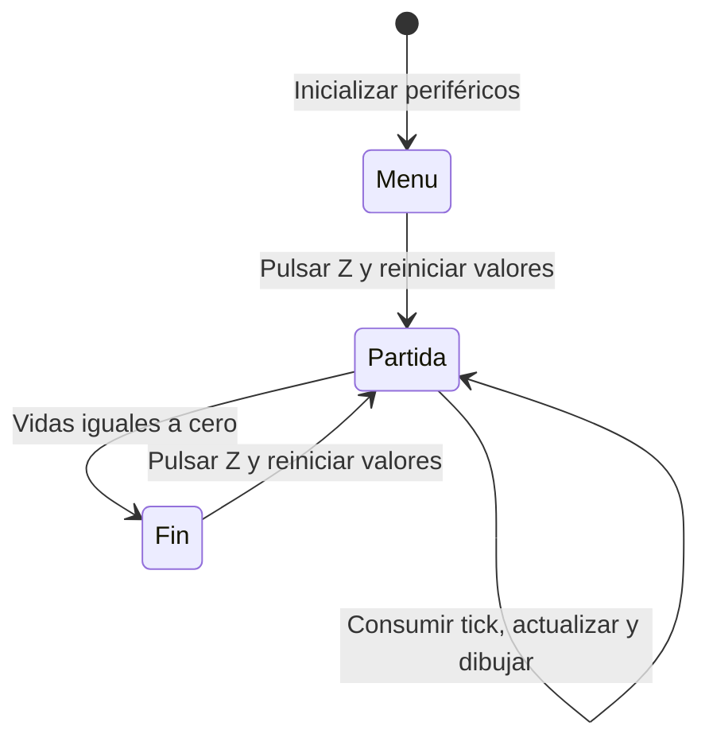

# Informe de funcionamiento del videojuego

## Carátula

**Proyecto:** ASTRO STRIKE  
**Tipo de proyecto:** Videojuego de naves para un microcontrolador RP2040  
**área:** Arquitectura de computadoras y programación en ensamblador  
**Fecha:** 6 de noviembre de 2026  
**Repositorio:** [https://github.com/cherreragt/Juego_Arquitectura](https://github.com/cherreragt/Juego_Arquitectura)  
**Video del proyecto:** [Ver video en Google Drive](https://drive.google.com/file/d/1fpVpAHT5NONzYjK607fSyaUkgoFhyrVP/view?usp=sharing)

---

## 1. Descripción y objetivo

ASTRO STRIKE es un videojuego de desplazamiento horizontal. El jugador controla una nave con un joystick, evita enemigos que avanzan desde la derecha y los destruye mediante un láser automático. Cada enemigo destruido aporta puntos. La partida termina cuando se agotan las tres vidas iniciales.

El proyecto muestra cómo integrar entradas analógicas, entradas digitales, interrupciones, memoria y una pantalla mediante acceso directo a los registros del microcontrolador. La lógica está escrita en ensamblador ARM para Cortex-M0+; un archivo Arduino sirve como punto de arranque.

Este informe describe la implementación presente en los archivos del repositorio. El video se incluye como enlace proporcionado para acompañar el proyecto; su contenido no fue revisado para elaborar la descripción técnica.

## 2. Hardware y conexiones definidas en el código

| Componente o señal | Conexión utilizada | Función |
| --- | --- | --- |
| Microcontrolador | RP2040, Cortex-M0+ | Ejecuta el programa y controla los periféricos |
| Joystick, eje X | GP26, ADC0 | Movimiento horizontal |
| Joystick, eje Y | GP27, ADC1 | Movimiento vertical |
| Botón Z | GP22 | Inicio y reinicio de partida |
| Pantalla OLED SSD1306 | 128 x 64 píxeles | Presenta menú, juego y resultado |
| SDA de la pantalla | GP4, I2C0 | Transmisión de datos |
| SCL de la pantalla | GP5, I2C0 | Reloj de comunicación |
| Dirección I2C de la pantalla | `0x3C` | Identifica el dispositivo OLED |

El botón está configurado como entrada con resistencia interna de pull-up: su estado normal es alto y una pulsación se reconoce al pasar a bajo. Los números GP corresponden a señales GPIO, no a números físicos de terminales de una placa específica. La alimentación y el montaje deben corresponder a la placa y los módulos utilizados; el repositorio no incluye un esquema eléctrico completo.

## 3. Organización del programa

| Archivo | Responsabilidad |
| --- | --- |
| [Proyecto_videojuego.ino](Proyecto_videojuego.ino) | Desde `setup()` llama a `game_main()` utilizando enlace C; `loop()` está vacío |
| [main.S](main.S) | Estados del juego, movimiento, colisiones, puntuación, vidas y composición de pantallas |
| [inputs.S](inputs.S) | Configuración del ADC y GPIO, lectura del joystick y detección de pulsación |
| [timer.S](timer.S) | Configuración de ALARM1, tabla de vectores e interrupción que marca cada actualización |
| [video.S](video.S) | Comunicación I2C, inicialización OLED, framebuffer, sprites y texto |

El programa separa las decisiones del juego del acceso a entradas, temporización y video. Las subrutinas intercambian parámetros mediante registros y usan la pila para conservar registros cuando corresponde.

## 4. Arranque y estados del juego

Al entrar en `game_main()`, el programa inicializa las entradas, la pantalla y el temporizador. Luego establece la semilla pseudoaleatoria `0xACE1`, selecciona el menú y dibuja la pantalla inicial.



| Estado | Valor | Comportamiento |
| --- | --- | --- |
| `STATE_MENU` | 0 | Muestra el título y espera una pulsación de Z |
| `STATE_PLAYING` | 1 | Actualiza la lógica cuando existe un tick pendiente |
| `STATE_GAMEOVER` | 2 | Mantiene la pantalla final y espera Z para otra partida |

El menú y la pantalla final son estáticos. El temporizador de la partida se activa al comenzar y se detiene al terminar. El bucle principal permanece consultando el estado y las señales correspondientes.

## 5. Reglas y desarrollo de una partida

Al iniciar o reiniciar se asignan cero puntos, tres vidas y la posición `(10, 32)` a la nave. Se desactiva el láser y los tres enemigos se sitúan en `(120, 16)`, `(155, 34)` y `(190, 50)`. Algunos comienzan fuera de la pantalla para entrar de forma escalonada.

En cada actualización se ejecuta esta secuencia:

1. Leer los dos ejes del joystick y desplazar la nave.
2. Crear un láser si no hay uno activo, o mover el existente.
3. Desplazar los tres enemigos y comprobar salidas y colisiones.
4. Revisar si quedan vidas y, si corresponde, terminar la partida.
5. Dibujar el cuadro de juego, salvo que ya se haya mostrado la pantalla final.

### Movimiento del jugador

El ADC entrega lecturas de 12 bits, entre 0 y 4095. `adc_to_delta()` las convierte en desplazamientos por actualización:

| Lectura ADC | Desplazamiento |
| --- | --- |
| 0 a 599 | -2 píxeles |
| 600 a 1499 | -1 píxel |
| 1500 a 2600 | 0 píxeles |
| 2601 a 3500 | +1 píxel |
| 3501 a 4095 | +2 píxeles |

La zona central evita movimientos por pequeñas variaciones alrededor del reposo. El código limita la coordenada X a `2..96` y la coordenada Y a `12..55`. El origen gráfico está arriba a la izquierda: aumentar X mueve a la derecha y aumentar Y mueve hacia abajo. La correspondencia física de la inclinación depende del cableado del joystick.

### Disparo y enemigos

El disparo es automático; el botón Z se utiliza para iniciar y reiniciar. Solo existe un láser activo a la vez. Se crea en `(X de la nave + 8, Y de la nave + 3)`, avanza cinco píxeles por actualización y se desactiva cuando su X alcanza o supera 126. Visualmente es una línea horizontal de cuatro píxeles.

Los tres enemigos avanzan hacia la izquierda dos píxeles por actualización. Si uno alcanza una X menor o igual a cero, resta una vida y reaparece en X = 128. También reaparece en esa posición después de recibir un disparo o chocar con la nave.

La nueva altura se obtiene mediante un registro de desplazamiento con realimentación lineal, o LFSR, que usa la máscara `0xB400`. El cálculo final `(estado & 31) + 14` produce posiciones Y entre 14 y 45. Es una secuencia determinista; su estado se conserva entre reinicios de partida dentro de la misma ejecución.

### Colisiones, puntuación y vidas

Las colisiones se calculan comparando rectángulos alineados con los ejes, técnica conocida como AABB. Para la nave y los enemigos se consideran extensiones de ocho píxeles por eje. La comprobación del láser utiliza márgenes de `+4` en X y `+2` en Y, aunque su representación visual es una línea de cuatro píxeles.

| Evento | Resultado |
| --- | --- |
| Láser contra enemigo | Desactiva el láser, suma 10 puntos y reposiciona al enemigo |
| Enemigo contra jugador | Resta una vida y reposiciona al enemigo |
| Enemigo sale por la izquierda | Resta una vida y reposiciona al enemigo |
| Vidas llegan a cero | Detiene el temporizador y muestra el resultado final |

La puntuación se limita a 999 y las vidas no descienden por debajo de cero. No hay un estado de victoria por alcanzar una puntuación: la partida continúa mientras queden vidas. No se implementa un periodo de invulnerabilidad, de modo que distintos enemigos pueden restar vidas en una misma actualización.

## 6. Temporización e interrupciones

`timer.S` utiliza ALARM1 del temporizador del RP2040 con un periodo programado de 33 333 microsegundos, equivalente aproximadamente a 30 ticks por segundo.

Durante la inicialización copia 48 entradas de la tabla de vectores a un área de RAM de 192 bytes, instala `timer1_isr()` en la entrada de IRQ1 y actualiza VTOR. El NVIC habilita esa interrupción.

La rutina de interrupción reconoce el evento, comprueba `physics_timer_enabled`, programa la siguiente alarma y activa `frame_tick_pending`. El bucle principal consulta y limpia esa bandera mediante `timer_check_and_clear_tick()` antes de actualizar la partida. El cálculo de colisiones y el dibujo se realizan fuera de la interrupción.

La frecuencia es un objetivo de temporización, no una medición de cuadros efectivos. El envío de la pantalla utiliza esperas activas y la bandera solo registra si existe trabajo pendiente; no cuenta todos los ticks que pudieran acumularse durante una actualización lenta.

## 7. Generación de imagen

El módulo de video reserva un framebuffer de 1024 bytes: `128 x 64 / 8`. Cada bit representa un píxel monocromático. Para dibujar un punto utiliza:

```text
índice del byte = (Y >> 3) * 128 + X
máscara del bit = 1 << (Y & 7)
```

Las subrutinas permiten limpiar la imagen, activar píxeles, dibujar líneas horizontales, representar sprites de 8 x 8 y escribir texto. Las naves y los caracteres se almacenan como tablas de bytes en la sección de solo lectura. Los números de tres cifras se convierten mediante restas sucesivas de centenas y decenas.

Durante la partida se dibuja el HUD con `PTS:` y `VID:`, una línea divisoria, la nave, el láser y los enemigos. `oled_flush()` envía la imagen completa mediante I2C en ocho bloques de 128 bytes. El menú muestra `ASTRO STRIKE` y `PULSA Z INICIAR`; la pantalla final muestra `GAME OVER` y la puntuación obtenida.

## 8. Variables principales y memoria

| Variable o grupo | Uso |
| --- | --- |
| `current_game_state` | Estado de la máquina de estados |
| `player_score`, `remaining_lives` | Puntuación y vidas |
| `player_position_x`, `player_position_y` | Posición de la nave |
| `laser_position_x`, `laser_position_y`, `laser_in_flight` | Posición y disponibilidad del láser |
| `enemy_positions_x`, `enemy_positions_y` | Arreglos de tres posiciones por eje |
| `enemy_height_lfsr_state` | Estado del generador de alturas |
| `previous_button_z_state` | Detección de transición del botón |
| `frame_tick_pending`, `physics_timer_enabled` | Coordinación entre interrupción y bucle principal |
| `interrupt_vectors_ram` | Copia de la tabla de vectores |
| `framebuffer` | Imagen monocromática que se envía a la pantalla |

Las variables se reservan estáticamente en `.bss`, las instrucciones se ubican en `.text` y las tablas gráficas y cadenas en `.rodata`. No se utiliza asignación dinámica de memoria.

## 9. Uso y alcance de la revisión

Para jugar, se enciende el sistema, se pulsa Z en el menú y se mueve el joystick para esquivar o alinear la nave con los enemigos. El disparo ocurre automáticamente. Tras perder las tres vidas, una nueva pulsación de Z inicia otra partida.

La compilación requiere un entorno Arduino compatible con RP2040 y ensamblador ARM para Cortex-M0+. El archivo `.ino` debe mantenerse junto a los cuatro archivos `.S`. El repositorio no especifica una versión de núcleo Arduino ni una configuración de placa que haya sido validada.

El informe se elaboró mediante lectura del código. No se realizó una compilación ARM ni una prueba en hardware, por lo que las reglas descritas corresponden al comportamiento programado y no constituyen una validación eléctrica o una medición de rendimiento.
